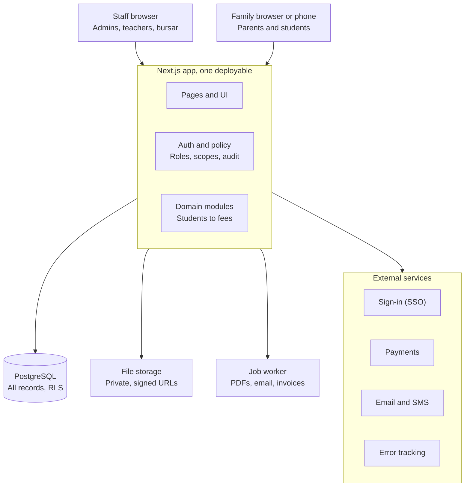

# School Management System: Build Plan

_Planning document, October 2026. No application code yet; this plan guides the rebuild of the current static prototype into a full system._

## Summary and assumptions

Build a web-based school management system (SMS) in five phases over about 48 weeks for a solo builder, starting with a core MVP by week 14 that covers students, classes, timetable, attendance, and grades. Everything else (fees, parent portal, messaging, reports, integrations) layers on top of that core.

The current repo is a static HTML + localStorage prototype (login, dashboard, students, classes, teachers, attendance). It is a useful clickable sketch of the screens; the real system replaces localStorage with a server and database as described below.

Decided on 21 Oct 2026: this is a **product for many schools, based in Ghana**, built with **Next.js + TypeScript + PostgreSQL + Tailwind**. The remaining assumptions stand until decided otherwise:

- **Multi-school from day one.** Many Ghanaian schools (KG, Primary, JHS, SHS) on one shared app, each with 300 to 1,500 students; every record carries a `school_id` and schools pay a per-student subscription by term.
- **Web first, mobile-friendly.** A responsive web app used on laptops by staff and on phones by parents and students. Native apps are deferred.
- **Six roles:** super admin, school admin, teacher, student, parent/guardian, and accountant/bursar.
- **One main builder.** Choices favour one well-known stack, managed hosting, and few moving parts over the most scalable option.
- **Ghana compliance.** Ghana's Data Protection Act 2012 applies: register with the Data Protection Commission, sign a data agreement with each school, and design to GDPR-level practice so the product can expand across West Africa later.
- **English UI, built so other languages can be added.** All strings go through an i18n layer from day one.

## Open questions

Questions 1 to 3 are answered (21 Oct 2026): many schools, Ghana, and Next.js + TypeScript + PostgreSQL. Because many parents pay by mobile money and use costly mobile data, question 8 now defaults to light pages plus an installable parent web app, with offline attendance in Phase 4.

The answers to these would change the plan, so they are worth settling before any code. The first three matter most.

| # | Question | Why it matters | Default if unanswered |
| --- | --- | --- | --- |
| 1 | Is this for one specific school, or a product sold to many schools? | Decides multi-tenancy, billing, onboarding, and how much admin tooling to build | One school, multi-tenant-ready schema |
| 2 | Which country or state will it run in? | Sets privacy law, grading scales, academic calendar, currency, and tax on fees | Design to GDPR-level practices |
| 3 | What tech stack do you already know? | A familiar stack beats a theoretically better one for a solo build | Next.js + PostgreSQL (see Architecture) |
| 4 | Which grade levels: primary only, secondary only, or K-12? | Secondary needs subject electives, period timetables, credits, and transcripts | K-12 |
| 5 | How many students and staff at launch, and in two years? | Sets hosting size and whether reporting needs a separate read store | 300 to 1,500 students |
| 6 | Must fees and payments be online, and through which provider? | Online payments add PCI scope, reconciliation, and refunds | Answered: Paystack or Hubtel, mobile money (MTN MoMo, Telecel Cash, AT Money) first, cards second |
| 7 | Is there existing data to migrate (spreadsheets, an old system)? | Migration tooling can take weeks | CSV import for students, staff, and classes |
| 8 | Do you need offline or low-bandwidth support? | Changes architecture toward a PWA with local sync | Online only, light pages |
| 9 | Which grading model: percentages, letters, GPA, or standards-based? | Shapes the gradebook and report card engine | Configurable scales per school |
| 10 | Any must-have integrations (Google Workspace, Microsoft 365, SMS gateway, government reporting)? | Each is its own mini-project | Google/Microsoft sign-in and email in Phase 2 |
| 11 | Budget for hosting and third-party services per month? | Picks managed vs self-hosted | Under $100 per month at launch |
| 12 | Who will support and train school staff after launch? | Affects how much self-service help, audit, and admin tooling is needed | The builder, with in-app help pages |

## Users and roles

Six roles cover a typical school; access is role-based and always scoped, so a teacher sees only their own classes and a parent only their own children.

| Role | Who | Main jobs in the system |
| --- | --- | --- |
| Super admin | The platform operator | Create schools, manage billing and plans, support access, system settings |
| School admin | Principal, registrar, office staff | Enrol students, manage staff, set up terms, classes, timetable, grading scales, publish report cards |
| Teacher | Class and subject teachers | Take attendance, post assignments, enter grades, write comments, message parents |
| Student | Enrolled learners | See timetable, assignments, grades, attendance, announcements; submit work |
| Parent/guardian | One or more per student | See their children's attendance, grades, fees, and messages; pay fees; give consent |
| Accountant/bursar | Finance staff | Fee structures, invoices, payments, receipts, arrears reports |

Permissions by module (R = read, W = write, own = only their own records or classes):

| Module | School admin | Teacher | Student | Parent | Accountant |
| --- | --- | --- | --- | --- | --- |
| Student records | W | R (own classes) | R (self) | R (own children) | R (billing fields) |
| Staff records | W | R (self) | none | none | R (payroll fields, later) |
| Classes and timetable | W | R | R (own) | R (own children) | none |
| Attendance | W | W (own classes) | R (self) | R (own children) | none |
| Gradebook | R, publish | W (own classes) | R (self, once published) | R (own children, once published) | none |
| Fees and payments | R | none | R (self) | R, pay (own children) | W |
| Messaging | W | W | W (to teachers) | W (to teachers, admin) | W (to parents, about fees) |
| Reports | W | R (own classes) | none | none | R (finance) |

Two rules to build in from day one: one person can hold several roles (a teacher who is also a parent), and every permission check runs on the server, never only in the UI.

## Scope and modules

Fourteen modules, grouped by the phase they ship in. The MVP is the modules a school needs every single day; the rest earn their place later.

| Module | Phase | Key features |
| --- | --- | --- |
| Identity and access | 1 | Email/password login, password reset, roles, invite links, optional 2FA for staff, session management |
| School setup | 1 | School profile, academic years, terms, grade levels, sections, subjects, holidays, grading scales |
| Student information | 1 | Admission form, profile, guardians, medical and emergency contacts, documents, status (enrolled, transferred, graduated), CSV import |
| Staff management | 1 | Staff profiles, roles, subjects taught, class teacher assignment |
| Classes and timetable | 1 | Sections, subject allocation, weekly period grid, teacher and room clash checks, printable timetables |
| Attendance | 1 | Daily or per-period marking, late/excused codes, bulk mark present, absence alerts, monthly summaries |
| Gradebook and assessments | 1 | Assessment types and weights, mark entry grid, computed term grades, publish/unpublish |
| Report cards | 2 | Templates, teacher and principal comments, PDF generation, bulk publish to parents |
| Parent and student portal | 2 | Dashboards for timetable, attendance, grades, assignments, announcements; multiple children per parent |
| Communication | 2 | Announcements by audience, 1-to-1 messaging teacher/parent, email notifications, SMS later |
| Assignments and homework | 2 | Post tasks with due dates and files, student submissions, grading links to gradebook |
| Fees and finance | 3 | Fee structures, discounts and scholarships, invoices, online payments, receipts, arrears, refunds |
| Reports and analytics | 3 | Attendance trends, grade distributions, at-risk students, enrolment, fee collection; CSV/PDF export |
| Admissions and enquiries | 4 | Online application, document upload, review pipeline, offer and enrol |

Later candidates, deliberately out of scope until the core is in use: library, transport and bus routes, hostel, inventory, HR and payroll, exam hall seating, LMS-style course content, native mobile apps, and an AI assistant for comments or timetabling.

## Data model

About 25 tables in a relational database, centred on one idea: a student is **enrolled** in a **section** for an **academic year**, and almost everything else (attendance, grades, fees) hangs off that enrolment.

| Area | Entity | Key fields | Relationships |
| --- | --- | --- | --- |
| Tenancy | School | name, timezone, locale, currency, settings | Parent of every other record via `school_id` |
| People | User | email, password hash, 2FA secret, status, last login | One user has many role assignments |
| People | RoleAssignment | user_id, role, scope (school, section) | Lets one person be teacher and parent |
| People | Student | admission no., names, DOB, gender, photo, status | Many guardians, many enrolments |
| People | Guardian | names, phone, email, relationship | Links to students through StudentGuardian (flags: primary, can pick up, receives billing) |
| People | Staff | employee no., names, job title, hire date | Teaches many sections and subjects |
| Calendar | AcademicYear, Term | start, end, is_current | Year has terms; terms bound grades and fees |
| Structure | GradeLevel, Section | name (Grade 7, 7B), capacity, class teacher | Section belongs to grade level and year |
| Structure | Subject, SectionSubject | code, name, credits; teacher_id | Which teacher teaches which subject to which section |
| Structure | Enrolment | student_id, section_id, year_id, roll no., status | Core link used by attendance, grades, fees |
| Timetable | Period, TimetableSlot, Room | day, period, section_subject_id, room_id | Clash checks on teacher and room |
| Attendance | AttendanceSession, AttendanceRecord | date, period?; status (present, absent, late, excused), note | Record per enrolment per session |
| Grades | GradingScale, Assessment, Mark | bands; type, weight, max score, term; score, comment | Mark per enrolment per assessment |
| Grades | ReportCard | term, computed results snapshot, comments, published_at | Frozen copy so later edits do not rewrite history |
| Learning | Assignment, Submission | title, due, files; submitted_at, file, grade | Optional link from assignment to an assessment |
| Messaging | Announcement, Conversation, Message | audience, body; participants; body, read_at | Audience rules use roles and sections |
| Finance | FeeType, FeeStructure, Invoice, InvoiceLine, Payment, Discount | amounts per grade/term; status, due; method, reference | Invoice per student per term; payments reconcile invoices |
| Platform | File, AuditLog, Notification | storage key, mime, size; actor, action, before/after; channel, status | Audit every write to grades, attendance, fees, and roles |

Design rules:

- Every table carries `id` (UUID), `school_id`, `created_at`, `updated_at`, and `created_by`. Soft-delete with `deleted_at` for people and finance records; never hard-delete grades or payments.
- Store money as integer minor units (cents/pesewas) with a currency code, never floats.
- Store timestamps in UTC and render in the school's timezone; store dates (like attendance date) as plain dates.
- Snapshot anything that gets published or paid (report cards, receipts) so later changes to scales or fees do not alter history.

## Architecture and stack

Build a **modular monolith**: one TypeScript web app, one PostgreSQL database, and a background worker, with each module (students, attendance, grades, fees) in its own folder behind clear interfaces. It is the fastest shape for one builder and splits cleanly into services later if it ever needs to.

Every request passes through the auth and policy layer before it reaches a module: it is the one part that must be right from the first release.

**Stack options**

| Option | Strengths | Weaknesses | Best if you |
| --- | --- | --- | --- |
| Next.js + TypeScript + PostgreSQL (recommended) | One language front to back, huge ecosystem, typed end to end, easy managed hosting | You build admin screens yourself; more framework churn | Know JavaScript or want a modern, hireable stack |
| Django + PostgreSQL + HTMX | Built-in admin, auth, ORM, and migrations; very fast for data-heavy CRUD | Rich interactive screens (timetable grid) take more work | Know Python |
| Laravel + PostgreSQL/MySQL | Batteries included (auth, queues, mail, billing); cheap hosting | PHP talent pool smaller in some regions | Know PHP |
| Adapt open source (Gibbon, OpenSIS, Fedena) | Months of features on day one | Inherit their data model, code quality, and licence terms | Need something running this term more than you need to learn by building |

**Recommended stack (if there is no strong preference)**

| Layer | Choice |
| --- | --- |
| Language | TypeScript everywhere |
| Web framework | Next.js (App Router) with server actions and route handlers |
| UI | Tailwind CSS + shadcn/ui; TanStack Table for grids like mark entry |
| Database | PostgreSQL 16+ on Neon, Supabase, or AWS RDS |
| ORM and migrations | Drizzle or Prisma |
| Validation | Zod schemas shared by forms and the API |
| Auth | Auth.js or Better Auth, with Google and Microsoft sign-in later |
| Background jobs | pg-boss (queue inside PostgreSQL) or BullMQ on Redis |
| Files | S3-compatible storage (AWS S3, Cloudflare R2) |
| PDFs | React-PDF or headless Chromium for report cards and receipts |
| Email and SMS | Resend or Postmark for email; Hubtel or Arkesel for SMS to parents |
| Payments | Paystack or Hubtel (mobile money and cards); the same gateway bills schools for their subscription |
| Hosting | Vercel or Render for the app, a small worker on Render or Fly.io |
| Monitoring | Sentry, plus uptime checks |
| Testing | Vitest, Playwright |

**Multi-tenancy:** use one shared database with `school_id` on every row plus PostgreSQL row-level security. It is the cheapest model to run and the easiest to back up; a school that demands isolation can later get its own database with the same schema.

## Security, privacy, and compliance

The system holds children's personal, medical, and financial data, so a leak is the single worst outcome; security is a Phase 1 requirement, not a later hardening pass.

**Access control**

- Role-based access with scope (school, section, own children) enforced in one server-side policy layer that every query passes through.
- PostgreSQL row-level security on `school_id` as a second safety net against cross-school leaks.
- 2FA required for school admins and accountants, optional for teachers and parents.
- Short-lived sessions in httpOnly, secure, SameSite cookies; log out everywhere on password change.

**Data protection**

- TLS everywhere; database and file storage encrypted at rest (default on managed providers).
- Passwords hashed with Argon2id or bcrypt; never stored or logged in plain text.
- Files in private object storage, served only through short-lived signed URLs after a permission check.
- Medical notes and identity numbers in separately permissioned fields, hidden from roles that do not need them.

**Application security**

- Validate every input with a schema (for example Zod); use parameterised queries through the ORM.
- CSRF protection, strict Content-Security-Policy, rate limiting on login and password reset.
- Dependency scanning (Dependabot or Renovate) and a secrets manager; no secrets in the repo.
- Run the OWASP Top 10 and ASVS Level 2 checklists before each phase goes live.

**Privacy and compliance**

- FERPA (US education records), COPPA (US, under-13s online), GDPR/UK GDPR (EU/UK), and local laws such as Ghana's Data Protection Act 2012, Kenya's, or India's data protection acts: confirm which apply (open question 2).
- Collect the minimum; document a retention period per data type (for example, attendance 7 years after leaving).
- Consent records for photos and communications; parents can export their child's data and request corrections.
- An audit log of who viewed or changed grades, attendance, fees, and roles, kept read-only.
- A data processing agreement with each school and with every subprocessor (hosting, email, SMS, payments).
- Payments through a hosted checkout (Stripe Checkout or a local gateway) so card data never touches your servers, keeping PCI scope to the lightest SAQ A level.

**Resilience**

- Automated daily backups with point-in-time recovery, a monthly restore test, and a written incident response and breach-notification plan.

## Phased roadmap

Five phases over about 48 weeks for one builder working close to full time; the date that matters early is week 14, when a pilot school should be taking attendance and entering marks in the system. Part-time, roughly double each phase.

| Phase | Weeks | Deliverables | Gate to pass before the next phase |
| --- | --- | --- | --- |
| 0 Foundations | 1 to 2 | Repo, CI, environments; auth and roles; schema and seed data; UI kit and layouts | **CI and auth done:** a pull request runs tests and deploys a preview; every role can sign in and sees only its own scope in the permission tests |
| 1 Core MVP | 3 to 14 | School setup; students and staff; classes and timetable; attendance; gradebook | **Pilot school live:** one real school has its students, staff, and timetable imported, and teachers have used attendance and the gradebook daily for two weeks with no data-loss bugs |
| 2 Portals | 15 to 24 | Report cards; parent portal; student portal; messaging; homework | **Parents onboarded:** at least half of pilot families have signed in, a full set of report cards has been published as PDFs, and messaging has been used in both directions |
| 3 Finance | 25 to 36 | Fee structures; invoices and receipts; online payments; reports and analytics | **Fees reconcile:** one billing term has been invoiced and paid online, and the payment report matches the gateway's settlement exactly |
| 4 Grow | 37 to 48 | Admissions; multi-school; integrations; installable PWA | |

Build order inside Phase 1 matters, because each module depends on the one before it: school setup, then students and staff, then classes and timetable, then attendance, then the gradebook. Keep a two-week buffer before the pilot gate for bug fixing and data import.

## Testing, deployment, and operations

Keep three environments (local, staging, production), deploy only from the main branch through CI, and treat seed data and tests as part of every feature.

**Testing**

- Unit tests for the rules that must never be wrong: grade calculations, attendance percentages, fee totals, permission checks.
- Integration tests against a real PostgreSQL (Testcontainers or a CI service container) for each API route.
- End-to-end tests with Playwright for the top flows per role: admin enrols a student, teacher marks attendance and enters marks, parent views a report card and pays a fee.
- A permission test matrix that tries every role against every endpoint and expects the right allow or deny.
- A realistic seed script (one school, 500 students, 40 staff, a full year) used for demos, tests, and load checks.

**Deployment**

- GitHub Actions runs lint, type-check, tests, and migrations check on every pull request.
- Preview deployments per pull request; staging on merge; production on a tagged release.
- Database migrations versioned in the repo and run automatically, always backwards-compatible for one release.
- Feature flags to switch modules on per school.

**Operations**

- Error tracking (Sentry), uptime checks, and structured logs with request IDs; never log personal data.
- Background jobs (report card PDFs, bulk emails, invoice runs) in a queue with retries.
- Plan for the yearly peaks: term start (enrolment), exam weeks (mark entry), and report card day.
- A year-end rollover tool that promotes students, archives the old year, and opens the new one; this is one of the most error-prone jobs in any SMS, so rehearse it on staging.
- Simple help pages and a support inbox; record common questions to drive fixes.

## Risks and next steps

The biggest risk is scope: school systems tempt you to build every module at once, so the plan's main defence is a narrow MVP used by one real school early.

| Risk | Likelihood | Impact | Mitigation |
| --- | --- | --- | --- |
| Scope creep delays any usable release | High | High | Freeze the Phase 1 list; park new ideas in a backlog reviewed at phase ends |
| Building without real school input | High | High | Recruit one pilot school before coding; show them screens every two weeks |
| Data leak across students or schools | Medium | Severe | Server-side policy layer, row-level security, permission test matrix, audit log |
| Grading and timetable rules differ by school | High | Medium | Make scales, weights, periods, and terms configurable rather than hard-coded |
| Year-end rollover corrupts data | Medium | High | Dedicated rollover tool, dry-run mode, backup before run, rehearse on staging |
| Messy legacy data on import | High | Medium | Strict CSV templates, validation preview, row-level error report |
| Solo builder burnout or bus factor | Medium | High | Managed services, one stack, written docs, small releases |
| Payment disputes or reconciliation errors | Medium | Medium | Hosted checkout, webhook-driven status, daily reconciliation report |
| Low adoption by teachers | Medium | High | Make attendance and mark entry faster than paper: under 60 seconds per class |
| Compliance gap found late | Low to medium | High | Settle jurisdiction now (open question 2); privacy review before each phase launch |

**Next steps (no code yet)**

- [ ] Answer open questions 1 to 3: one school or many, which country, which stack
- [ ] Find a pilot school and interview an admin, two teachers, and two parents about their week
- [ ] Turn the data model into an ER diagram and review it against the pilot school's real records
- [ ] Sketch low-fidelity screens for the five Phase 1 daily flows (the current prototype pages are a head start)
- [ ] Write a one-page Phase 1 scope with acceptance criteria per module
- [ ] Set up the repo, CI, and environments as Phase 0
